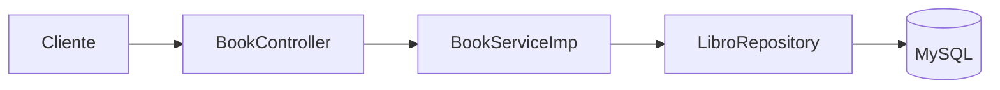
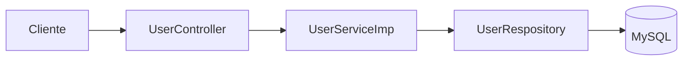
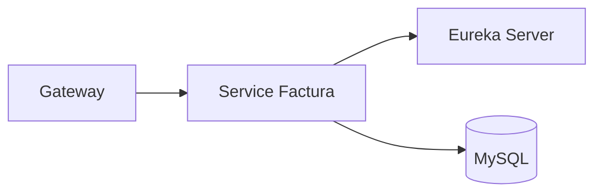
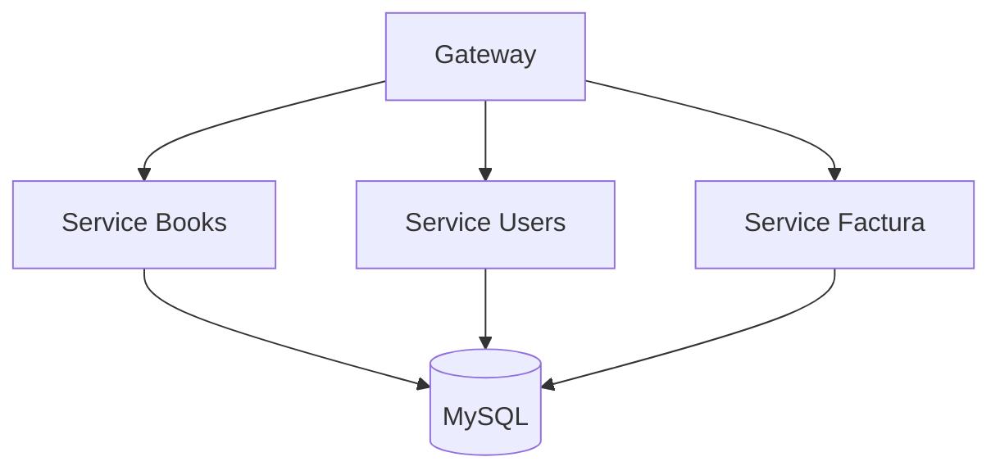

# Módulo de Dominio de Negocio

[← Volver al README principal](../README.md)

## Descripción

Este módulo concentra la lógica funcional del negocio de la librería. Aquí se implementan los servicios relacionados con la gestión de libros, usuarios y otros procesos del dominio.

## Componentes principales

### 1. Service Books

Ubicación: [DominioNegocio/service-books](service-books)

**Función:**
- gestionar libros
- consultar categorías
- crear, listar, actualizar y eliminar libros
- exponer endpoints REST del módulo de librería

**Diagrama funcional:**

### 2. Service Users

Ubicación: [DominioNegocio/service-users](service-users)

**Función:**
- gestionar usuarios
- buscar por nombre de usuario
- actualizar datos del usuario
- integrar con el sistema de seguridad

**Diagrama funcional:**

### 3. Service Factura

Ubicación: [DominioNegocio/service-factura](service-factura)

**Función:**
- mantener una lógica de facturación dentro del ecosistema de negocio
- completar el conjunto funcional del dominio comercial

**Diagrama funcional:**

---

## Arquitectura del módulo

---

## Resumen del módulo

El módulo de negocio encapsula la lógica principal de la aplicación. Está pensado para que cada servicio gestione un dominio concreto y se comunique con la base de datos y con la capa de seguridad según sea necesario.
