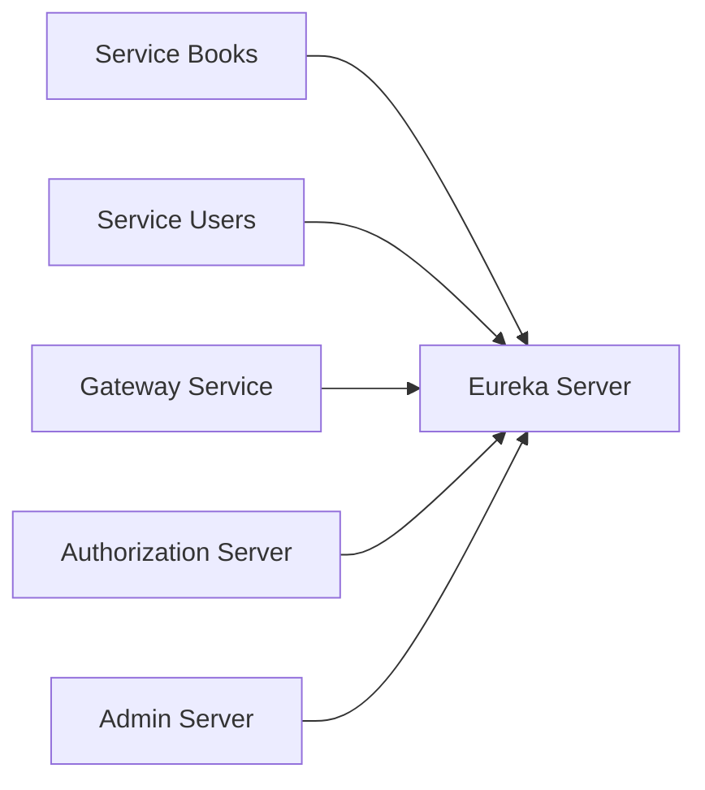
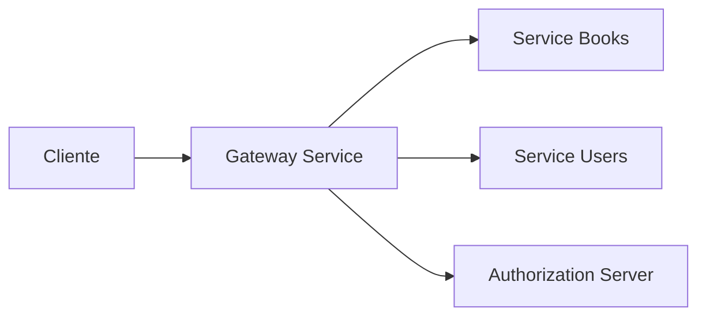
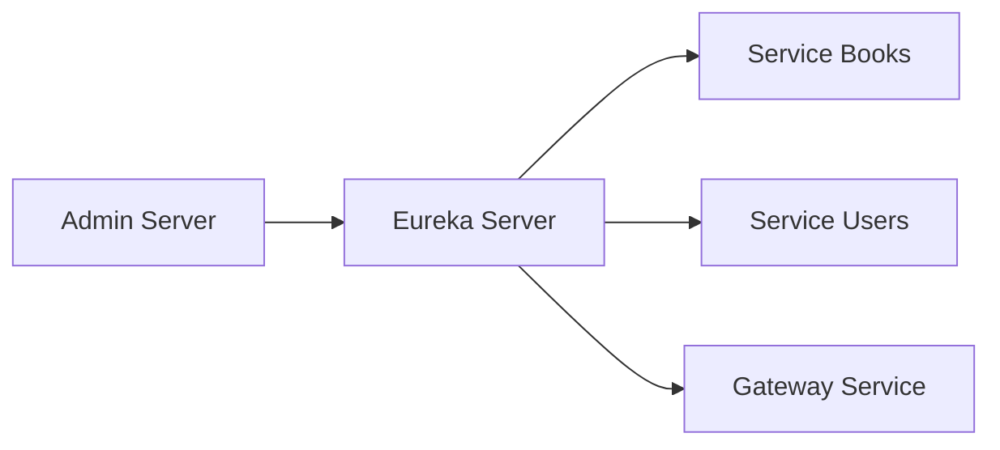
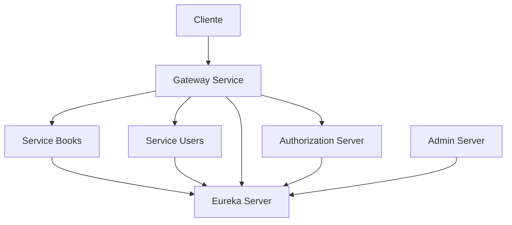

# Módulo de Infraestructura

[← Volver al README principal](../README.md)

## Descripción

La infraestructura del proyecto contiene los servicios transversales que permiten que la aplicación funcione como un ecosistema de microservicios. Aquí se centralizan la observabilidad, la gestión de servicios y la entrada principal a las APIs.

## Componentes principales

### 1. Eureka Server

Ubicación: [Infraestructura/eureka-server](eureka-server)

**Función:**
- registrar todos los microservicios
- permitir el descubrimiento dinámico de servicios
- dar una vista central del estado del sistema

**Diagrama:**

### 2. Gateway Service

Ubicación: [Infraestructura/gateway-service](gateway-service)

**Función:**
- ser el punto único de entrada para clientes
- enrutar peticiones hacia servicios del dominio
- validar JWT y aplicar seguridad del flujo principal

**Diagrama:**

### 3. Admin Server

Ubicación: [Infraestructura/admin-server](admin-server)

**Función:**
- monitorear servicios y métricas del sistema
- facilitar la administración del ecosistema
- ofrecer una vista central del estado operativo

**Diagrama:**

---

## Arquitectura del módulo

---

## Resumen del módulo

Este módulo actúa como la base operacional del proyecto. Sin él, los microservicios no tendrían registro, enrutamiento ni administración centralizada. También soporta la seguridad y la orquestación de rutas entre componentes.
