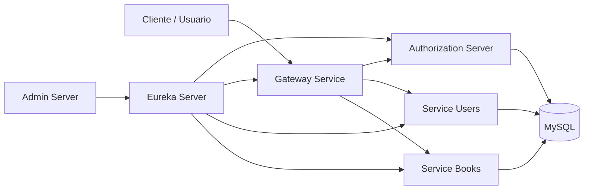
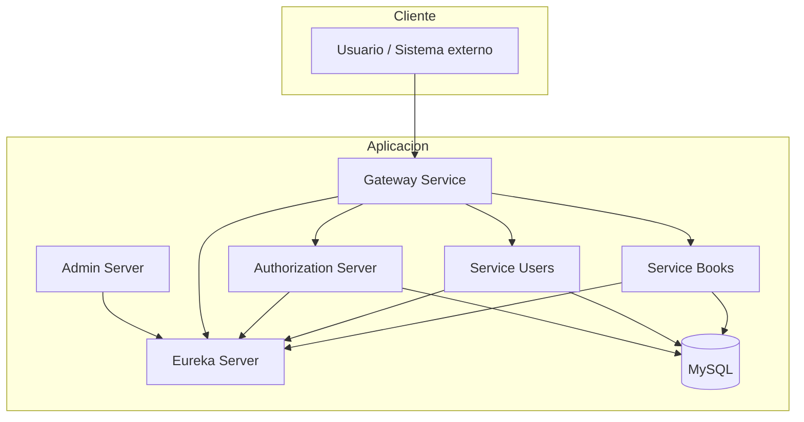
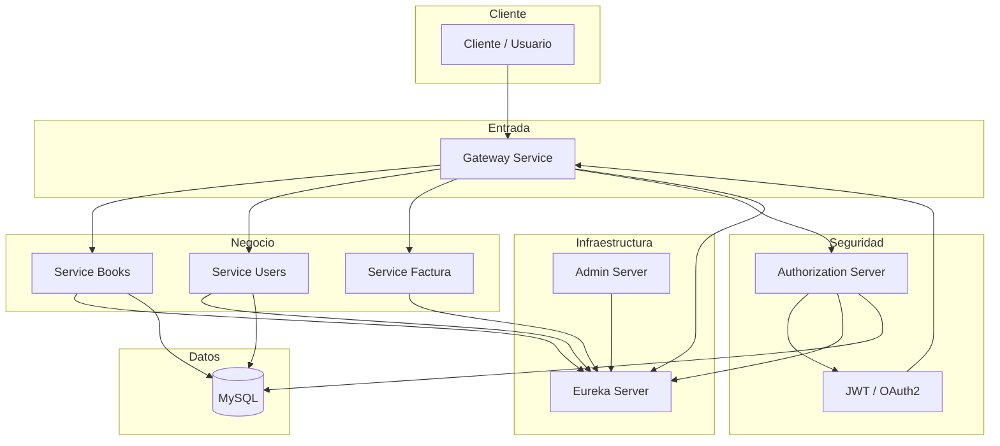
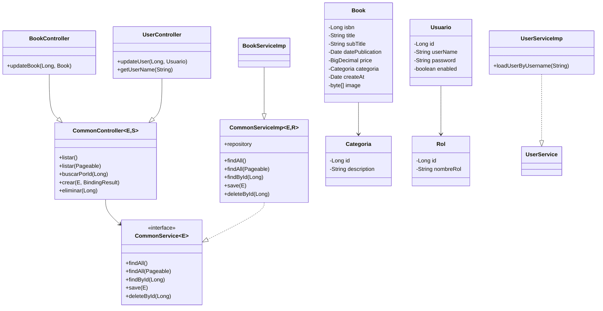
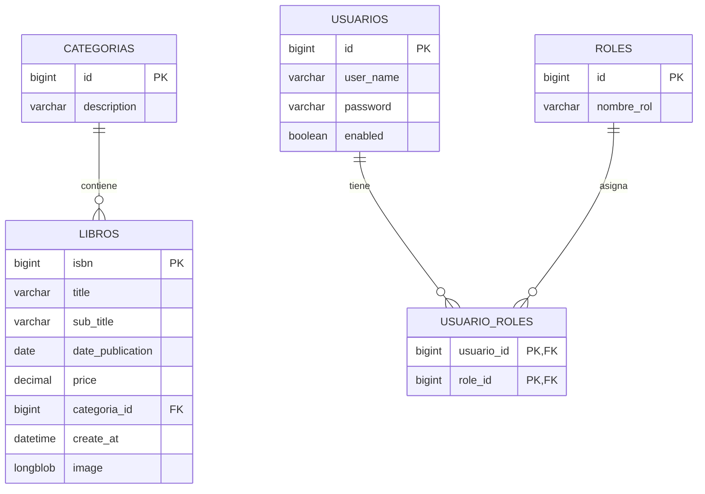

# Libreria - Documentación general del proyecto

## Resumen general

Libreria es un proyecto de backend basado en microservicios desarrollado con Java y Spring Boot. Su objetivo es gestionar una librería digital mediante servicios independientes que se coordinan a través de infraestructura común, seguridad y una base de datos relacional.

El sistema está dividido en cuatro grandes bloques:

- Infraestructura: descubrimiento, gateway y administración
- Dominio de negocio: servicios de libros y usuarios
- Seguridad: autenticación y autorización con OAuth2 / JWT
- Commons: entidades y servicios reutilizables

Este enfoque permite separar responsabilidades, facilitar la escalabilidad y mantener un diseño modular para futuras extensiones del sistema.

---

## Arquitectura general

### Descripción de la arquitectura

- El cliente accede al sistema mediante un único punto de entrada: el Gateway.
- El Gateway distribuye las solicitudes hacia los microservicios del negocio.
- Eureka registra y descubre cada servicio del ecosistema.
- El Authorization Server genera y valida tokens JWT para proteger los endpoints.
- Los servicios del dominio acceden a la base de datos MySQL para persistir la información.
- El Admin Server permite monitorear y administrar la infraestructura.

---

## Inventario de módulos

| Módulo | Ruta | Función principal | Componentes clave |
|---|---|---|---|
| Infraestructura | [Infraestructura](Infraestructura) | Descubrimiento, gateway y administración | Eureka, Gateway, Admin Server |
| DominioNegocio | [DominioNegocio](DominioNegocio) | Lógica funcional del negocio | service-books, service-users, service-factura |
| Seguridad | [Seguridad](Seguridad) | Autenticación y autorización | Authorization Server, OAuth2, JWT |
| Commons | [commons](commons) | Entidades y servicios compartidos | common-libros, commons-usuarios, commons-service |

---

## Documentación por módulo

### 1. Infraestructura

Responsable de la base operativa del sistema.

- Registro y descubrimiento de servicios con Eureka
- Entrada centralizada del sistema con Gateway
- Administración y monitoreo con Admin Server
- Despliegue con Docker Compose

Ir a: [Infraestructura/README.md](Infraestructura/README.md)

### 2. Dominio de negocio

Contiene la lógica funcional relacionada con la librería y gestión del negocio.

- libros y categorías
- usuarios y roles
- servicios REST del dominio
- procesos transversales del negocio

Ir a: [DominioNegocio/README.md](DominioNegocio/README.md)

### 3. Seguridad

Encargado de proteger la aplicación y controlar los accesos.

- autenticación de usuarios
- emisión de tokens JWT
- validación de tokens en el Gateway
- control de roles y permisos

Ir a: [Seguridad/README.md](Seguridad/README.md)

### 4. Commons

Repositorio compartido con entidades y utilidades comunes.

- entidades de dominio reutilizables
- lógica base para servicios y controladores
- reducción de duplicación de código

Ir a: [commons/README.md](commons/README.md)

---

## Diagrama general del contexto

---

## Diagrama general de componentes

---

## Diagrama general de clases

---

## Diagrama general de base de datos

---

## Tecnologías principales

- Java 21
- Spring Boot 4
- Spring Cloud
- Spring Security
- OAuth2 Authorization Server
- Eureka
- Spring Cloud Gateway
- JPA / Hibernate
- MySQL
- Docker Compose

---

## Estado del proyecto

El proyecto presenta una estructura modular clara y una separación adecuada de responsabilidades. La solución está preparada para crecer, agregar nuevos servicios y fortalecer la seguridad en la capa de acceso y negocio.

Este README representa la documentación general del repositorio. La información detallada de cada bloque queda en los READMEs específicos de cada módulo.
