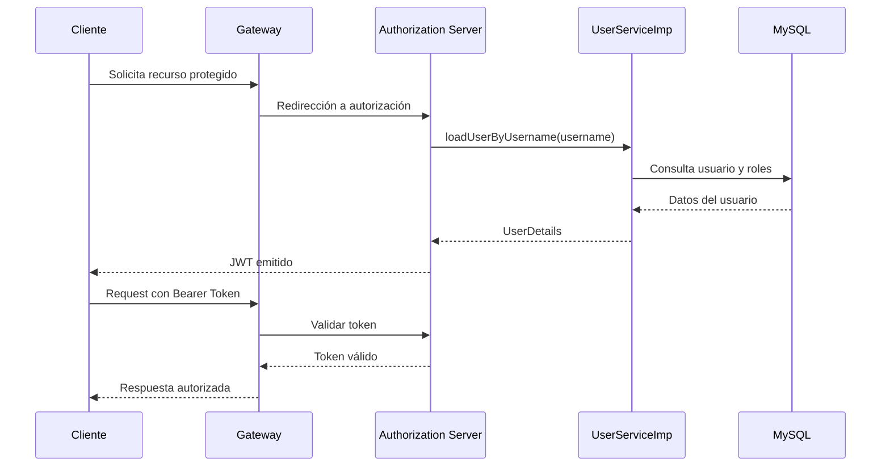
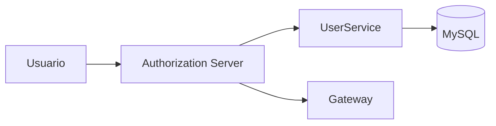
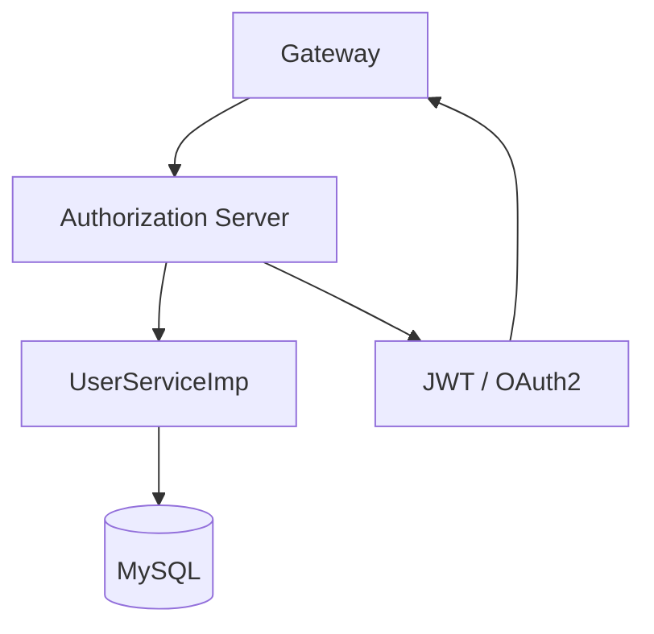

# Módulo de Seguridad

[← Volver al README principal](../README.md)

## Descripción

La capa de seguridad del proyecto gestiona la autenticación, autorización y validación de usuarios mediante OAuth2 y JWT. Esta capa es esencial para proteger los endpoints y controlar el acceso a los servicios del sistema.

## Componentes principales

### 1. Authorization Server

Ubicación: [Seguridad/seguridad](seguridad)

**Función:**
- emitición de tokens JWT
- autenticación de usuarios
- registro de clientes OAuth2
- validación de permisos y roles

**Diagrama funcional:**

### 2. Modulo adicional de seguridad

Ubicación: [Seguridad/Autorization-server](Autorization-server)

**Función:**
- complementar la configuración de seguridad del proyecto
- apoyar la integración con OpenFeign y validación de identidad
- mantener una segunda implementación o alternativa de autorización

**Diagrama:**

---

## Arquitectura del módulo

---

## Resumen del módulo

La seguridad está diseñada para brindar control centralizado de acceso al ecosistema. A través del Authorization Server, los usuarios son autenticados y reciben tokens que permiten acceder a los recursos protegidos a través del Gateway.
