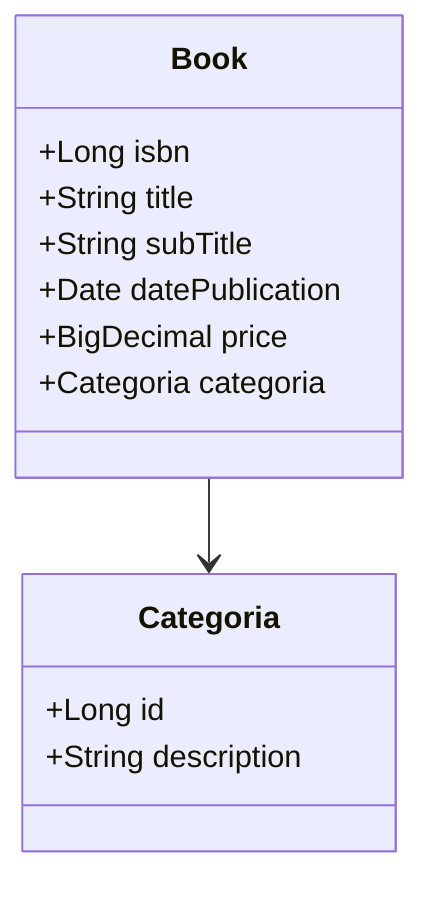
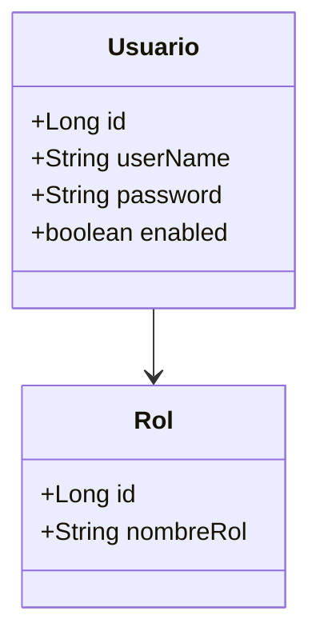
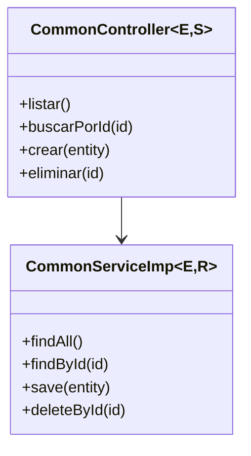
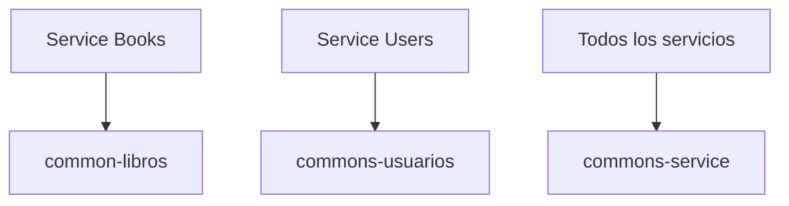

# Módulo de Commons

[← Volver al README principal](../README.md)

## Descripción

El módulo de commons centraliza las entidades, utilidades y servicios genéricos compartidos por los distintos microservicios del proyecto. Su finalidad es evitar duplicación de código y mantener una base común para la capa de negocio.

## Componentes principales

### 1. common-libros

Ubicación: [commons/common-libros](common-libros)

**Función:**
- define la entidad `Book`
- define la entidad `Categoria`
- modela el dominio del libro y su categoría

**Diagrama:**

### 2. commons-usuarios

Ubicación: [commons/commons-usuarios](commons-usuarios)

**Función:**
- define la entidad `Usuario`
- define la entidad `Rol`
- modela la relación entre usuarios y roles

**Diagrama:**

### 3. commons-service

Ubicación: [commons/commons-service](commons-service)

**Función:**
- define el patrón de CRUD base para controladores y servicios
- reutiliza lógica común del dominio
- facilita la extensión de nuevos módulos

**Diagrama:**

---

## Arquitectura del módulo

---

## Resumen del módulo

Este módulo es la base común del proyecto. Proporciona los modelos y la lógica repetitiva que otros servicios usan para construir su funcionalidad sin duplicar código ni romper la coherencia del dominio.
