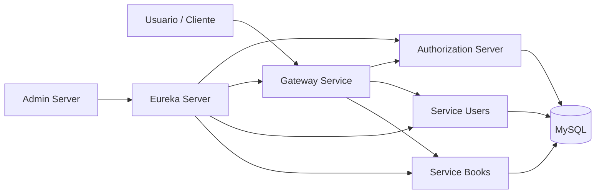
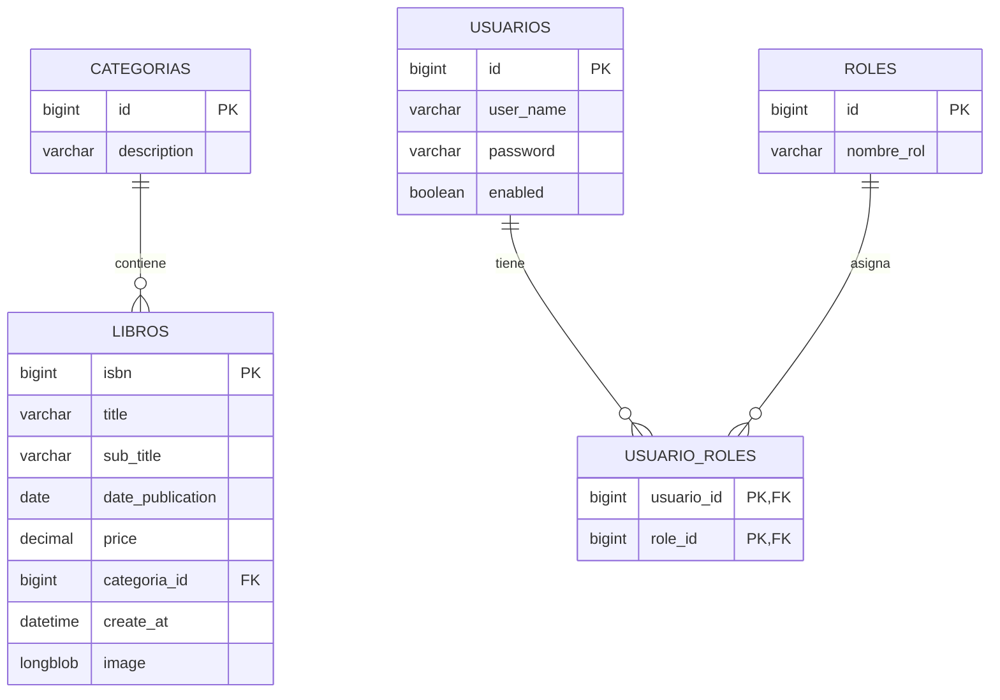
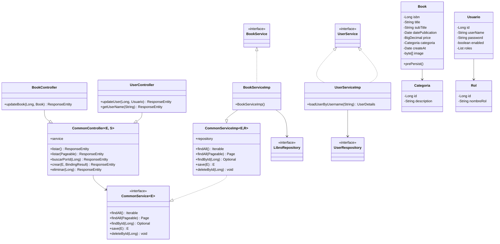
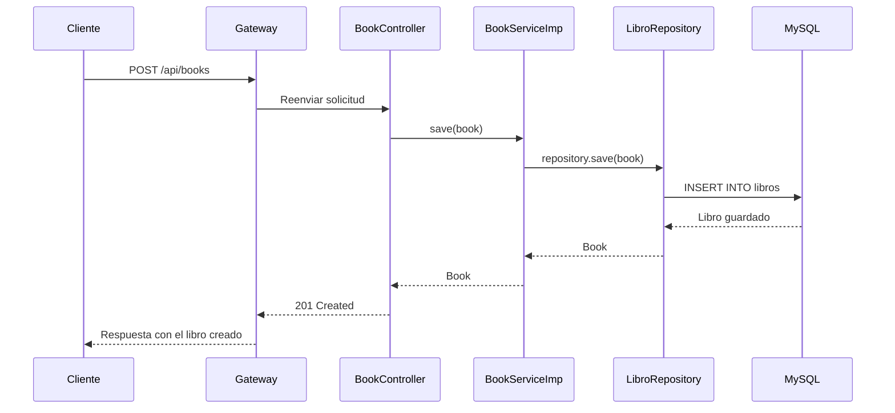
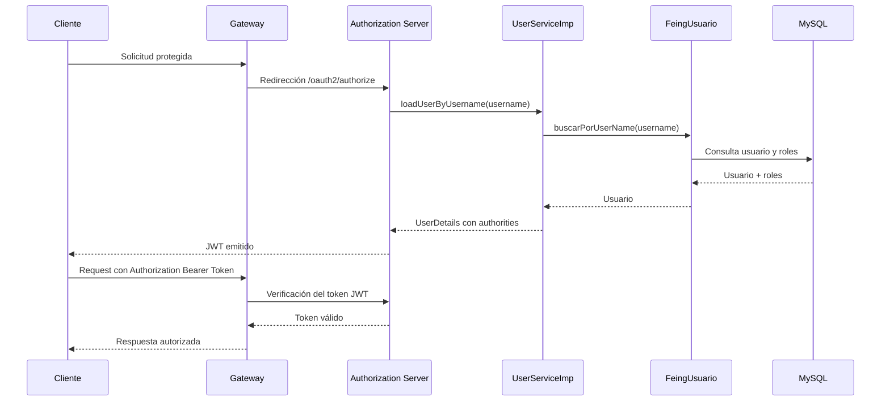
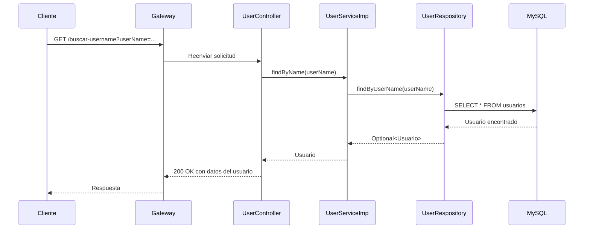
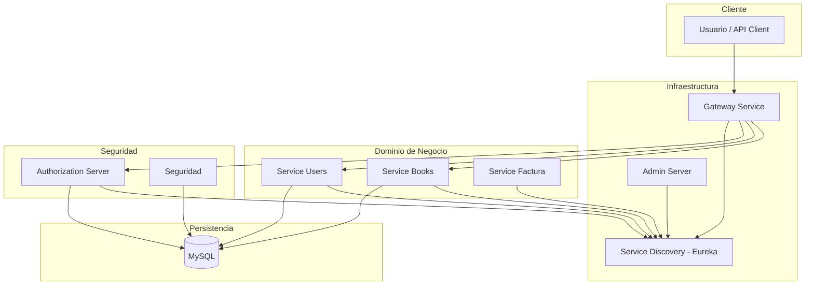

# Documentación del proyecto Libreria

## 1. Resumen general

Este repositorio corresponde a una arquitectura de microservicios desarrollada con Java, Spring Boot y Spring Cloud. La solución está dividida en varios módulos con responsabilidades bien definidas:

- Infraestructura: descubrimiento de servicios, gateway, administración y monitoreo.
- Dominio de negocio: servicios para usuarios y libros.
- Seguridad: autenticación y autorización con OAuth2 / JWT.
- Commons: entidades y servicios reutilizables compartidos entre módulos.

La aplicación principal modela un sistema de librería con gestión de libros, categorías, usuarios y roles, donde los servicios se exponen a través de un gateway y se protegen con un servidor de autorización.

### Objetivo funcional

- Administrar libros y categorías.
- Registrar y consultar usuarios con sus roles.
- Exponer APIs a través de un API Gateway.
- Registrar servicios con Eureka.
- Gestionar identidad y autorización con OAuth2.
- Utilizar MySQL como base de datos relacional.

### Stack tecnológico

- Java 21
- Spring Boot 4.0.6
- Spring Cloud 2025.1.1
- Spring Security
- OAuth2 Authorization Server
- Eureka Server / Client
- Spring Cloud Gateway
- Spring Data JPA
- MySQL
- Docker / Docker Compose

### Arquitectura general

El proyecto usa una arquitectura basada en microservicios con estas capas:

1. Cliente / Gateway
2. Router de entrada: gateway-service
3. Registro y descubrimiento: eureka-server
4. Servicios de negocio: service-books, service-users, service-factura
5. Seguridad: service-oauth2-authorization-server / seguridad
6. Base de datos relacional MySQL compartida por servicios
7. Panel administrativo: admin-server

---

## 2. Inventario de módulos y microservicios

### 2.1 Módulo raíz

- `pom.xml`: proyecto multimódulo principal.
- Define módulos de infraestructura, dominio de negocio, seguridad y commons.

### 2.2 Infraestructura

#### `Infraestructura/eureka-server`
- Función: servicio de descubrimiento y registro de microservicios.
- Nombre de aplicación: `servidor-eureka`
- Puerto por defecto: `8761`
- Tecnología: Spring Cloud Netflix Eureka

#### `Infraestructura/gateway-service`
- Función: punto de entrada único para las APIs.
- Nombre de aplicación: `gateway-service`
- Puerto por defecto: `8760`
- Ruta configurada: `/api/books/**` hacia `service-books`
- Seguridad: validación JWT con OAuth2 Resource Server

#### `Infraestructura/admin-server`
- Función: administración y monitoreo del ecosistema.
- Se registra en Eureka.

### 2.3 Dominio de negocio

#### `DominioNegocio/service-books`
- Función: gestión de libros y categorías.
- Nombre de aplicación: `service-books`
- Puerto dinámico por defecto (`PORT:0` en local)
- Entidades principales:
  - `Book`
  - `Categoria`
- Repositorio:
  - `LibroRepository`
- Controlador:
  - `BookController`
- Servicio:
  - `BookService`, `BookServiceImp`

#### `DominioNegocio/service-users`
- Función: gestión de usuarios y autenticación local.
- Nombre de aplicación: `service-users`
- Puerto dinámico por defecto (`PORT:0`)
- Entidades principales:
  - `Usuario`
  - `Rol`
- Repositorio:
  - `UserRespository`
- Controlador:
  - `UserController`
- Servicio:
  - `UserService`, `UserServiceImp`

#### `DominioNegocio/service-factura`
- Función: servicio de facturación presente en el proyecto, pero menos desarrollado dentro de la estructura actual.
- Se registra como microservicio de negocio con Eureka.

### 2.4 Seguridad

#### `Seguridad/seguridad`
- Función: servidor de autenticación y autorización basado en OAuth2 Authorization Server.
- Puerto por defecto: `9000`
- Herramientas:
  - Spring Security
  - OpenID Connect
  - JWT
- Se configura para emitir y validar tokens.
- Repositorio de clientes:
  - `gateway-app`

#### `Seguridad/Autorization-server`
- Función: módulo adicional de autorización, similar al patrón de autenticación del proyecto.
- Usa OpenFeign y Spring Security.
- Está conceptualizado como una segunda implementación o una alternativa de autenticación.

### 2.5 Commons

#### `commons/common-libros`
- Contiene entidades compartidas para libros y categorías.
- Paquete base: `com.cava.examples.common.entitis`

#### `commons/commons-usuarios`
- Contiene entidades compartidas para usuarios y roles.
- Paquete base: `com.cava.examples.common.entitis`

#### `commons/commons-service`
- Define abstracciones de controladores y servicios reutilizables.
- `CommonController`
- `CommonService`
- `CommonServiceImp`

---

## 3. Diagrama de base de datos general

La base de datos principal del proyecto se modela con entidades JPA y relaciones de negocio. La estructura base es una relación entre categorías, libros, usuarios y roles.

### Relación funcional

- Una categoría puede tener muchos libros.
- Un libro pertenece a una sola categoría.
- Un usuario puede tener muchos roles.
- Un rol puede estar asignado a muchos usuarios.

---

## 4. Definición de tablas por componente

### 4.1 Componente: Books / Librería

#### Tabla `Categorias`

| Campo | Tipo | Restricciones | Descripción |
|---|---|---|---|
| id | BIGINT | PK, AUTO_INCREMENT | Identificador de la categoría |
| description | VARCHAR | NOT NULL | Nombre o descripción de la categoría |

#### Tabla `Libros`

| Campo | Tipo | Restricciones | Descripción |
|---|---|---|---|
| isbn | BIGINT | PK, AUTO_INCREMENT | Identificador del libro |
| title | VARCHAR |  | Título |
| sub_title | VARCHAR |  | Subtítulo |
| date_publication | DATE |  | Fecha de publicación |
| price | DECIMAL |  | Precio del libro |
| categoria_id | BIGINT | FK -> categorias.id | Relación con la categoría |
| create_at | DATETIME |  | Fecha de creación |
| image | LONGBLOB |  | Imagen de portada |

#### Observaciones
- La entidad `Book` usa `@ManyToOne` con `Categoria`.
- `create_at` se completa automáticamente con `@PrePersist`.
- La tabla física se define como `Libros`.

### 4.2 Componente: Usuarios / Seguridad

#### Tabla `roles`

| Campo | Tipo | Restricciones | Descripción |
|---|---|---|---|
| id | BIGINT | PK, AUTO_INCREMENT | Identificador del rol |
| nombre_rol | VARCHAR |  | Nombre del rol (USER, ADMIN, PROFESOR) |

#### Tabla `usuarios`

| Campo | Tipo | Restricciones | Descripción |
|---|---|---|---|
| id | BIGINT | PK, AUTO_INCREMENT | Identificador del usuario |
| user_name | VARCHAR |  | Nombre de usuario |
| password | VARCHAR |  | Contraseña cifrada |
| enabled | BOOLEAN |  | Estado del usuario |

#### Tabla `usuario_roles`

| Campo | Tipo | Restricciones | Descripción |
|---|---|---|---|
| usuario_id | BIGINT | PK, FK -> usuarios.id | Usuario asociado |
| role_id | BIGINT | PK, FK -> roles.id | Rol asociado |

#### Observaciones
- La relación es `@ManyToMany` en `Usuario`.
- La tabla `usuario_roles` define la asociación con una restricción única sobre `usuario_id` y `role_id`.

### 4.3 Componente: Seguridad / OAuth2

La seguridad no define una entidad relacional adicional dentro del proyecto de negocio, sino un modelo de autorización basado en:

- Clientes OAuth2 registrados.
- Usuario autenticado y roles asociados.
- JWT emitido por el Authorization Server.
- Gateway validando el token con `issuer-uri` y `jwk-set-uri`.

### 4.4 Componente: Infraestructura / Servicios

No existen tablas propias de infraestructura en el modelo JPA del proyecto, pero sí hay registro de servicios en Eureka y rutas de enrutamiento en Gateway.

---

## 5. Diagrama de clases

### Observaciones sobre el diagrama

- Los controladores reutilizan la base abstracta `CommonController`.
- Los servicios heredan de `CommonServiceImp`, que encapsula lógica básica de CRUD.
- `Book` tiene una relación `ManyToOne` con `Categoria`.
- `Usuario` tiene una relación `ManyToMany` con `Rol`.
- `UserServiceImp` implementa `UserDetailsService` para integración con Spring Security.

---

## 6. Diagramas de secuencia por componente

### 6.1 Secuencia: creación de un libro

### 6.2 Secuencia: autenticación de usuario y emisión de JWT

### 6.3 Secuencia: consulta de usuario por username

---

## 7. Mapa de componentes del sistema

---

## 8. Principales decisiones de diseño

- Separación por módulos y responsabilidades.
- Uso de commons para reutilizar entidades y servicios base.
- Gateway como eje de entrada para todas las rutas.
- Registro de servicios centralizado con Eureka.
- Seguridad externalizada con OAuth2 + JWT.
- Persistencia relacional en MySQL mediante JPA.
- Patrón genérico de CRUD en `CommonController` y `CommonServiceImp`.

---

## 9. Estado actual del proyecto

El proyecto presenta una base sólida de microservicios y capas compartidas, con una estructura modular clara. Los elementos más desarrollados actualmente son:

- gestión de libros
- gestión de usuarios y roles
- autenticación con OAuth2
- registro de servicios y gateway
- entidad compartida de negocio

Se observa además una intención de crecer con:

- facturación
- monitoreo administrativo
- expansión de seguridad y control de accesos
- despliegue con Docker Compose y contenedores

---

## 10. Resumen ejecutivo

La solución se presenta como un sistema de librería basado en microservicios, donde cada funcionalidad está separada en módulos y conectada mediante Spring Cloud. La capa de infraestructura facilita descubrimiento, orquestación y acceso centralizado, mientras que la capa de negocio gestiona las entidades del dominio y la capa de seguridad protege las comunicaciones con tokens JWT.

La parte más representativa del modelo de datos se centra en:

- libros por categoría
- usuarios con roles
- relación entre usuarios y permisos
- autenticación centralizada y validación del token en el gateway

---

## 11. Archivos relevantes del proyecto

- `pom.xml` — módulo raíz
- `docker-compose.yaml` — orquestación de infraestructura y servicios
- `Infraestructura/eureka-server` — discovery
- `Infraestructura/gateway-service` — API Gateway
- `DominioNegocio/service-books` — gestión de libros
- `DominioNegocio/service-users` — gestión de usuarios
- `Seguridad/seguridad` — OAuth2 / autorizador
- `commons/common-libros` — entidades de libros
- `commons/commons-usuarios` — entidades de usuarios
- `commons/commons-service` — servicios base

Este documento debe entenderse como una vista de arquitectura funcional del repositorio, basada en las entidades y servicios reales observados en el código fuente.
